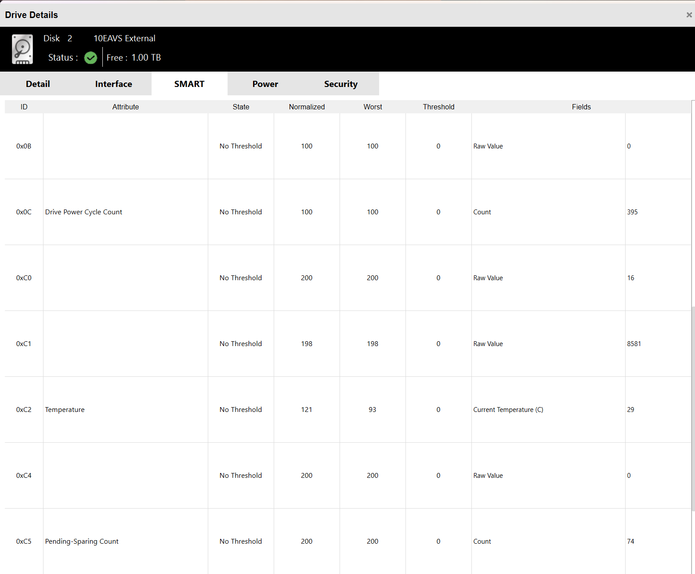
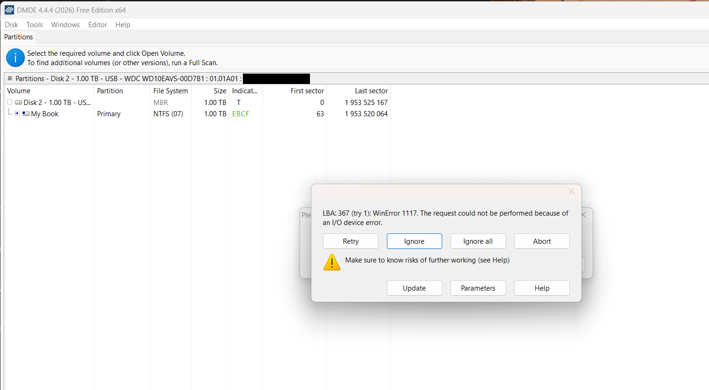

# 01 — Storage Device Diagnostics

## Overview

This activity evaluated the health and reliability of four mechanical hard drives to determine their suitability for continued use, data recovery, backup storage, or retirement.

Diagnostic results were used to guide subsequent recovery, migration, and sanitization procedures.

## Objectives

- Identify storage devices and their physical characteristics.
- Interpret Self-Monitoring, Analysis and Reporting Technology (SMART) attributes.
- Perform manufacturer-provided diagnostic tests.
- Identify signs of storage degradation and potential failure.
- Determine appropriate actions based on diagnostic findings.

## Hardware Inventory

| Device | Capacity | Interface | Purpose |
| :--- | :--- | :--- | :--- |
| Western Digital My Book (WD10EAVS-00D7B1) | 1 TB | USB | Forensic recovery investigation |
| Seagate Portable | 2 TB | USB | Backup destination |
| Hitachi HDD | Not recorded | Internal | Existing data storage and backup source |
| Western Digital 10EAVS External | 1 TB | USB | Sanitization and retirement |

## Tools

| Tool | Purpose |
| :--- | :--- |
| SeaTools | SMART assessment and extended drive diagnostics |
| DMDE | Disk inspection and identification of read errors |
| Windows PowerShell | Storage device and partition identification |
| Windows DiskPart | Physical disk inspection |
| Windows Disk Management | Partition and volume inspection |
| Ubuntu Linux | Device identification and recovery preparation |

## 1. Seagate Portable 2 TB — Backup Destination

**Assessment date:** October 17–18, 2026

The Seagate external HDD was evaluated before being selected as the destination for a large data backup.

### SMART Assessment

SMART data was exported before and after extended diagnostic testing.

| SMART ID | Attribute | Raw Value |
| :--- | :--- | ---: |
| 05 | Reallocated Sector Count | 0 |
| 10 | Spin Retry Count | 0 |
| 187 | Reported Uncorrectable Errors | 0 |
| 188 | Command Timeout | 27 |
| 197 | Current Pending Sector Count | 0 |
| 198 | Offline Uncorrectable Sector Count | 0 |
| 199 | UltraDMA CRC Error Count | 0 |

The Command Timeout attribute remained unchanged during testing. No increase was observed in the critical sector-related attributes.

The exported Power-On Hours value was not interpreted as a conventional hour count because of its manufacturer-specific representation.

### Extended Diagnostic Testing

| Test | Result |
| :--- | :--- |
| SMART assessment | No critical sector-related indicators |
| Long Drive Self Test (DST) | PASS |
| Long Generic Test | PASS |
| Post-test SMART review | No new critical errors |

### Assessment

The Seagate demonstrated no reallocated, pending, or uncorrectable sectors in the recorded SMART assessment and successfully completed both extended diagnostic tests.

**Decision:** Approve the drive for backup storage.

A passing diagnostic assessment indicates that no relevant failures were detected during testing; it does not guarantee future reliability.

## 2. Western Digital My Book 1 TB — Failing Drive

**Assessment date:** October 18, 2026

The Western Digital My Book was an older external HDD believed to have previously contained media files. Diagnostics were performed to determine its condition before attempting recovery.

### Device Identification

| Property | Value |
| :--- | :--- |
| Manufacturer | Western Digital |
| Model | WD10EAVS-00D7B1 |
| Capacity | 1 TB |
| Power-On Hours | 58,025 |
| Power Cycle Count | 395 |
| Temperature | 29°C |

### SMART Assessment

| SMART ID | Attribute | Raw Value |
| :--- | :--- | ---: |
| 05 | Reallocated Sector Count | 0 |
| C5 | Current Pending Sector Count | 74 |
| C6 | Offline Uncorrectable Sector Count | 0 |
| C7 | UltraDMA CRC Error Count | 0 |

The presence of 74 pending sectors indicated that portions of the disk could not be read reliably and required further investigation.

Although the diagnostic application displayed a positive overall health indicator, the individual SMART attributes and observed read errors indicated that the drive was at risk.

#### Supporting Evidence — SMART Diagnostics



*Figure 1. SMART diagnostic results showing 74 pending sectors on the Western Digital My Book HDD.*

### Read Error Investigation

DMDE encountered the following read failure:

| Property | Result |
| :--- | :--- |
| Logical Block Address (LBA) | 367 |
| Windows error code | 1117 |
| Error type | Device I/O error |

The error provided additional evidence that the drive could not reliably return data from all sectors.

#### Supporting Evidence — Device Read Failure



*Figure 2. DMDE reporting a device I/O error at logical block address 367, confirming unreliable sector access.*

### Assessment

The combination of advanced operating age, pending sectors, and actual read failures made the drive unsuitable for continued dependable storage.

**Decision:**

1. Prioritize data preservation.
2. Avoid unnecessary writes or destructive testing.
3. Acquire a sector-level image using GNU ddrescue.
4. Conduct the recovery investigation against the acquired image.
5. Retire the original drive after completing the investigation.

The imaging and recovery procedures are documented in [02 — Forensic Imaging and Recovery](02-forensic-imaging-and-recovery.md).

## 3. Hitachi HDD — Aging Data Storage

**Assessment date:** November 2026

The Hitachi HDD was installed in the Windows gaming desktop and contained personal documents, photographs, videos, and other files.

### Diagnostic Findings

| Property | Result |
| :--- | :--- |
| SMART health classification | Caution |
| Reallocated sectors | 1 |
| Data accessibility | Accessible |
| Continued reliability | At risk |

The reallocated sector indicated that the drive had replaced a problematic physical sector with a spare sector.

A reallocated sector alone does not establish imminent failure. However, it provided sufficient reason to prioritize protecting the existing data.

### Assessment

Because the drive remained accessible, the immediate priority was to preserve the data rather than perform additional intensive diagnostic testing.

**Decision:** Back up the existing files to the previously tested Seagate 2 TB drive.

The backup, permission troubleshooting, integrity comparison, and restoration tests are documented in [03 — Backup and Restoration](03-backup-and-restoration.md).

## 4. Western Digital 10EAVS External — Retirement Candidate

**Assessment date:** November 14, 2026

A second Western Digital external HDD was identified for retirement. The device exhibited intermittent connectivity and inconsistent volume accessibility.

### Windows Storage Identification

The following read-only PowerShell command was used:

```powershell
Get-Disk | Format-Table Number, FriendlyName, BusType, Size, HealthStatus, PartitionStyle
```

Observed results:

| Property | Result |
| :--- | :--- |
| Disk number | 2 |
| Friendly name | WD 10EAVS External |
| Bus type | USB |
| Capacity in bytes | 1,000,204,886,016 |
| Windows health status | Healthy |
| Partition style | MBR |

The existing partition was inspected:

```powershell
Get-Partition -DiskNumber 2 |
Format-Table PartitionNumber, DriveLetter, Type, Size
```

| Property | Result |
| :--- | :--- |
| Partition number | 1 |
| Drive letter | E: |
| Partition type | IFS |
| Capacity in bytes | 1,000,202,241,024 |

### Connectivity Investigation

An attempt to inspect the volume returned an error:

```powershell
Get-ChildItem -LiteralPath "E:\" -Force
```

```text
Cannot find drive. A drive with the name 'E' does not exist.
```

Additional disk-level inspection confirmed that Windows could still detect the physical storage device:

```powershell
Get-Disk -Number 2 |
Format-List FriendlyName, OperationalStatus, HealthStatus, IsOffline, IsReadOnly
```

Observed results:

```text
FriendlyName      : WD 10EAVS External
OperationalStatus : Online
HealthStatus      : Healthy
IsOffline         : False
IsReadOnly        : False
```

The disk was subsequently inspected using DiskPart:

```text
list disk
select disk 2
detail disk
```

DiskPart identified the device as a WD 10EAVS External USB Device containing a 931 GB RAW partition.

### Assessment

The Windows health status did not reflect the intermittent connectivity and filesystem-access problems observed during the investigation.

The RAW filesystem classification indicated that Windows could not recognize the existing filesystem. It did not establish that the drive had been securely erased.

**Decision:** Do not reuse the drive. Proceed with disk-level sanitization, independent read-back verification, and electronics recycling.

The sanitization procedure is documented in [05 — Sanitization and Retirement](05-sanitization-and-retirement.md).

## Final Diagnostic Decisions

| Device | Assessment | Action |
| :--- | :--- | :--- |
| Seagate Portable 2 TB | Passed extended diagnostics | Approved as backup destination |
| WD My Book 1 TB | Pending sectors and read failures | Forensic acquisition, recovery investigation, retirement |
| Hitachi HDD | SMART caution and reallocated sector | Prioritize data backup |
| WD 10EAVS External 1 TB | Intermittent connectivity and RAW filesystem | Secure sanitization and retirement |

## Lessons Learned

- SMART health classifications must be evaluated alongside individual attributes and actual device behavior.
- A drive can report a healthy status while exhibiting read failures or connectivity problems.
- Pending and reallocated sectors warrant investigation and appropriate data protection measures.
- Data preservation should take priority over intensive testing when a drive is showing signs of degradation.
- Extended diagnostic testing can help establish whether a drive is suitable for a proposed storage role.
- Diagnostic results should directly inform recovery, backup, replacement, and retirement decisions.

## Limitations

- SMART attributes and raw values may be manufacturer-specific.
- Passing diagnostic tests cannot guarantee future drive reliability.
- The Seagate extended test outcomes were recorded during testing, but the original standalone test-result reports were not retained.
- The exact Hitachi model and complete SMART attribute export were not recovered from the historical project records.
- A complete SMART attribute assessment was not recorded for the second Western Digital drive. Its retirement decision was based on observed accessibility and connectivity problems.

## Navigation

- [Return to Storage Lifecycle Management](README.md)
- [Next: Forensic Imaging and Recovery](02-forensic-imaging-and-recovery.md)
