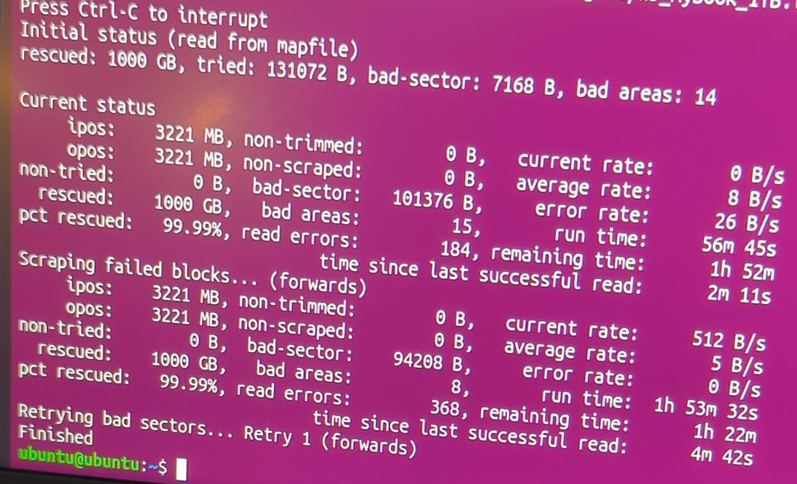
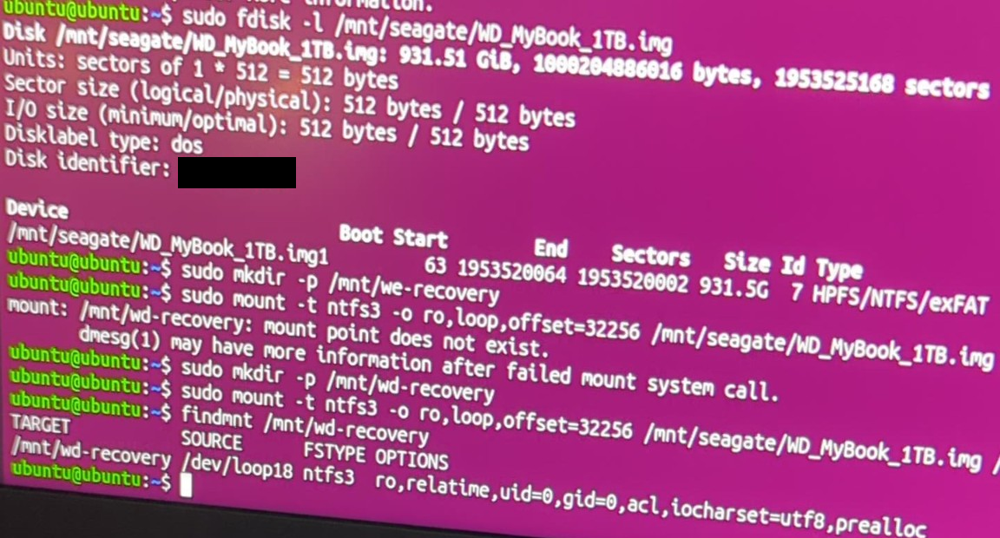
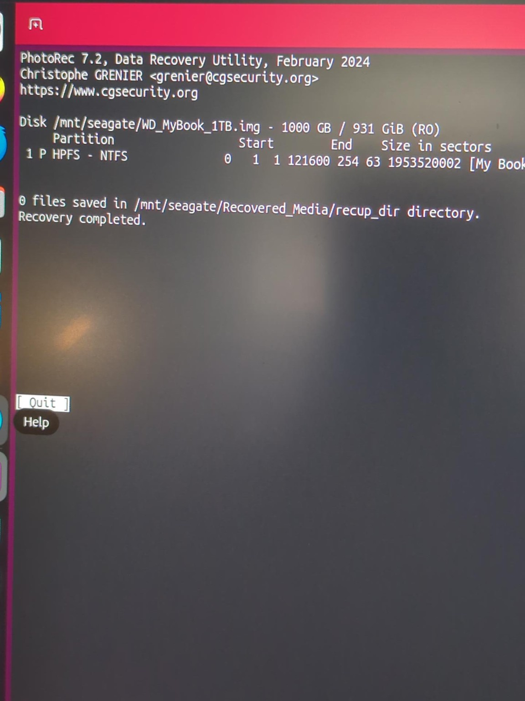
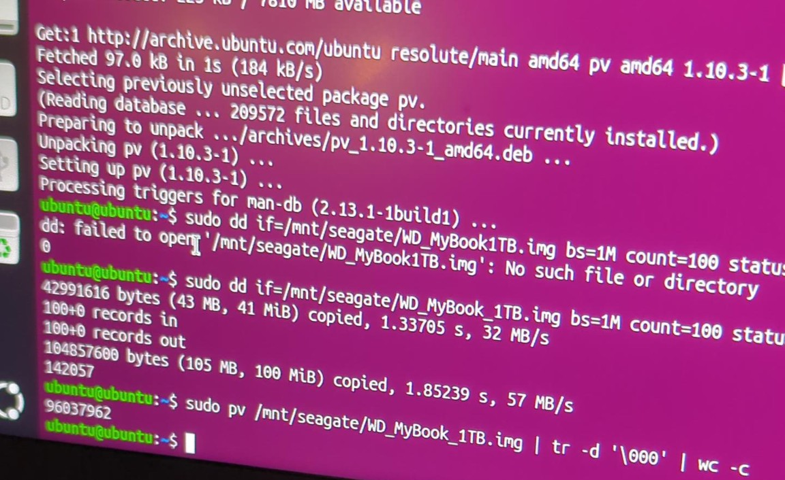

# 02 — Forensic Imaging and Recovery

## Overview

This activity investigated an aging Western Digital My Book 1 TB external HDD that previously contained media files.

The drive had been formatted years earlier and was exhibiting signs of physical degradation. The objective was to determine whether previously stored media could be recovered while minimizing further stress on the original device.

A sector-level image was acquired using GNU ddrescue, followed by filesystem inspection and data recovery analysis using Linux-based recovery utilities.

**Project dates:** October 18–21, 2026

## Objectives

- Preserve accessible data from a failing storage device.
- Create a sector-level disk image using a recovery-oriented acquisition tool.
- Record acquisition errors and unreadable regions.
- Inspect the acquired image without modifying the original drive.
- Investigate deleted or previously formatted data using filesystem and file-carving techniques.
- Evaluate recovery potential and determine whether further investigation was justified.

## Hardware and Environment

| Component | Description |
| :--- | :--- |
| Source device | Western Digital My Book 1 TB external HDD |
| Drive model | WD10EAVS-00D7B1 |
| Source interface | USB |
| Destination | Seagate Portable 2 TB external HDD |
| Operating system | Ubuntu Linux |
| Boot environment | Ubuntu live USB |
| Original filesystem | NTFS |
| Partition table | MBR/DOS |

## Tools

| Tool | Purpose |
| :--- | :--- |
| GNU ddrescue | Fault-tolerant sector-level disk imaging |
| fdisk | Partition table and filesystem offset identification |
| mount / findmnt | Read-only image mounting and verification |
| TestDisk | Partition and filesystem recovery investigation |
| PhotoRec | Signature-based file carving |
| pv | Monitor data-processing progress |
| tr / wc | Examine nonzero data within the acquired image |
| DMDE | Preliminary Windows-based disk inspection |

## 1. Initial Drive Assessment

The source drive had previously been examined using SMART diagnostics and DMDE.

Recorded findings included:

| Indicator | Result |
| :--- | :--- |
| Power-on hours | 58,025 |
| Current pending sectors | 74 |
| Reallocated sectors | 0 |
| Observed read error | LBA 367 |
| Windows error | 1117 — Device I/O error |

The drive exhibited actual read failures despite reporting a positive overall health indicator.

These findings established that continued direct recovery attempts against the original drive could introduce unnecessary risk.

**Decision:** Acquire an image of the failing drive before conducting the primary recovery investigation.

Additional diagnostic details are available in [01 — Storage Device Diagnostics](01-drive-diagnostics.md).

## 2. Recovery Environment Preparation

The computer was booted into Ubuntu Linux using a live USB environment.

The Western Digital source drive and Seagate destination drive were identified before beginning acquisition.

| Role | Device or Path |
| :--- | :--- |
| Original WD source | `/dev/sdc` |
| Destination mount | `/mnt/seagate` |
| Acquired image | `/mnt/seagate/WD_MyBook_1TB.img` |
| Recovery mapfile | `/mnt/seagate/WD_MyBook_1TB.map` |

The Seagate provided sufficient storage capacity for the approximately 932 GiB raw disk image.

### Recovery precautions

- Avoid unnecessary writes to the failing source drive.
- Preserve readable data before attempting repeated reads of damaged regions.
- Maintain a ddrescue mapfile to track acquisition progress.
- Conduct filesystem inspection and recovery against the acquired image.

> Device names are specific to this lab session. Linux device assignments can change between boots and must always be verified before executing disk-level commands.

## 3. Sector-Level Disk Acquisition

### Initial acquisition

GNU ddrescue was selected because it can recover readable regions while recording unreadable areas for subsequent retry attempts.

The initial acquisition used:

```bash
sudo ddrescue -n \
  /dev/sdc \
  /mnt/seagate/WD_MyBook_1TB.img \
  /mnt/seagate/WD_MyBook_1TB.map
```

The `-n` option skips the scraping phase, prioritizing acquisition without immediately spending excessive time on difficult regions.

### Initial acquisition results

| Metric | Recorded Result |
| :--- | :--- |
| Data recovered | 99.99% |
| Unrecovered data | 7,168 bytes |
| Reported read errors | 24 |
| Reported bad areas | 14 |
| Elapsed time | 17 hours, 40 minutes, 47 seconds |

The initial pass successfully acquired nearly the entire addressable disk.

The mapfile preserved information about completed and problematic regions, allowing further acquisition attempts without restarting the entire imaging process.

### Retry acquisition

A subsequent pass attempted to recover remaining problematic regions:

```bash
sudo ddrescue -d -r1 \
  /dev/sdc \
  /mnt/seagate/WD_MyBook_1TB.img \
  /mnt/seagate/WD_MyBook_1TB.map
```

Options:

- `-d`: Use direct disk access for the input device.
- `-r1`: Perform one retry pass.
- Existing mapfile: Resume acquisition using previously recorded results.

### Retry results

| Metric | Recorded Result |
| :--- | :--- |
| Data recovered | Approximately 99.99% |
| Reported unrecovered data | 94,208 bytes |
| Reported read errors | 368 |
| Reported bad areas | 8 |
| Elapsed time | Approximately 1 hour, 53 minutes |

The retry process continued to encounter read failures.

The reported unrecovered byte count increased compared with the earlier acquisition output. Both observations were retained rather than replacing them with an assumed or corrected result.

The image was suitable for further investigation, but it could not be described as a complete, error-free copy of the original disk.

#### Supporting Evidence — ddrescue Acquisition Results



*Figure 1. GNU ddrescue retry results documenting approximately 99.99% acquisition, 94,208 unreadable bytes, 368 read errors, and eight bad areas.*

### Acquisition artifacts

- `WD_MyBook_1TB.img` — sector-level disk image
- `WD_MyBook_1TB.map` — acquisition progress and recovery map
- `WD_MyBook_1TB.map.bak` — mapfile backup

## 4. Partition and Filesystem Inspection

The acquired image was inspected to determine its partition layout.

```bash
sudo fdisk -l /mnt/seagate/WD_MyBook_1TB.img
```

### Partition findings

| Property | Result |
| :--- | :--- |
| Partition table | MBR/DOS |
| Number of partitions | 1 |
| Partition type | NTFS (ID 7) |
| Starting sector | 63 |
| Logical sector size | 512 bytes |
| Filesystem offset | 32,256 bytes |

The filesystem offset was calculated from the starting sector:

```text
63 sectors × 512 bytes = 32,256 bytes
```

### Read-only image mounting

The NTFS partition was mounted from the acquired image using its calculated byte offset:

```bash
sudo mount -t ntfs3 \
  -o ro,loop,offset=32256 \
  /mnt/seagate/WD_MyBook_1TB.img \
  /mnt/wd-recovery
```

The `ro` option prevented ordinary filesystem writes to the mounted image.

The mount was inspected using `findmnt`.

### Mount results

| Property | Result |
| :--- | :--- |
| Loop device | `/dev/loop18` |
| Filesystem | NTFS / ntfs3 |
| Mount point | `/mnt/wd-recovery` |
| Access mode | Read-only |

The visible filesystem contained only standard Windows system directories:

- `$RECYCLE.BIN`
- `System Volume Information`

Some directory metadata could not be read normally.

No accessible personal media files were identified through ordinary filesystem inspection.

#### Supporting Evidence — Partition Inspection and Read-Only Mount



*Figure 2. Linux terminal output demonstrating partition identification, filesystem offset calculation, and read-only mounting of the acquired disk image.*

## 5. TestDisk Recovery Investigation

TestDisk was used to investigate the acquired image and examine its NTFS partition and directory structure.

The investigation focused on determining whether:

- The original filesystem remained identifiable.
- Previously stored directories could be enumerated.
- Deleted media could be located through filesystem recovery.

### Results

| Investigation | Outcome |
| :--- | :--- |
| Partition identification | NTFS partition identified |
| Filesystem inspection | Limited accessible directory information |
| Recoverable media | None identified |

The filesystem-based investigation did not identify the expected media collection.

**Decision:** Continue with signature-based file carving, which does not depend on intact directory entries or filenames.

## 6. PhotoRec File-Carving Investigation

PhotoRec was used to search the acquired disk image for recoverable files based on known file signatures.

Unlike ordinary filesystem recovery, file carving searches underlying data for recognizable file structures.

The recovery destination was located separately from the source image:

```text
/mnt/seagate/Recovered_Media
```

### Results

| Property | Result |
| :--- | :--- |
| Recovery method | Signature-based file carving |
| Input | Acquired WD disk image |
| Scan | Completed |
| Files recovered | 0 |
| Media recovered | None |

PhotoRec did not recover any recognizable files from the scanned image.

The result established that the recovery methods used during this investigation did not identify recoverable media.

It did not establish that every possible professional recovery technique would produce the same result.

#### Supporting Evidence — PhotoRec Recovery Results



*Figure 3. PhotoRec signature-based recovery scan completed with zero recovered files, supporting the findings of the filesystem-based investigation.*

## 7. Raw Image Data Investigation

Because filesystem recovery and file carving produced no useful media, the acquired image was examined to determine how much nonzero data remained.

Linux utilities including `pv`, `tr`, and `wc` were used to process the raw image and quantify bytes that were not zero.

### Results

| Metric | Result |
| :--- | :--- |
| Acquired image size | Approximately 932 GiB |
| Nonzero data identified | Approximately 91.6 MiB |
| Recognizable recovered media | None |

The limited amount of nonzero data supported the assessment that the image contained very little remaining information relative to its total capacity.

This finding was consistent with extensive previous clearing or overwriting of the drive, although the exact historical formatting method could not be established.

Nonzero data alone does not prove that recoverable files are present.

#### Supporting Evidence — Raw Image Analysis



*Figure 4. Raw image analysis using Linux utilities identified approximately 91.6 MiB of nonzero data within the approximately 932 GiB acquired image.*

## 8. Recovery Assessment and Final Decision

The recovery investigation combined several independent observations:

1. SMART diagnostics identified pending sectors.
2. Disk inspection confirmed actual read failures.
3. GNU ddrescue acquired nearly the entire disk, with documented unreadable regions.
4. Read-only filesystem inspection identified no accessible personal media.
5. TestDisk did not identify recoverable media.
6. PhotoRec recovered zero files.
7. Raw image inspection identified only a small amount of nonzero data.

### Final assessment

| Question | Conclusion |
| :--- | :--- |
| Was the source drive suitable for continued use? | No |
| Was a sector-level image acquired? | Yes, with documented unreadable regions |
| Was the filesystem inspected? | Yes |
| Were multiple recovery methods attempted? | Yes |
| Was the expected media recovered? | No |
| Was further recovery justified? | No, given the available findings and expected cost |

The expected value of additional recovery attempts did not justify further intensive testing or professional recovery costs.

The original drive was subsequently retired and recycled.

## 9. Forensic Integrity Verification

The original acquisition was validated using ddrescue acquisition statistics, recovery mapfiles, partition inspection, and successful read-only mounting.

A SHA-256 checksum was not retained for the original Western Digital disk image.

The original image was subsequently removed after the recovery investigation was completed.

To demonstrate cryptographic disk-image integrity verification, a separate controlled lab was completed using a 64 MiB virtual disk.

That lab demonstrated:

- Source SHA-256 hash generation before acquisition.
- Sector-level image acquisition.
- Matching source and acquired-image hashes.
- Read-only filesystem inspection.
- Successful extraction of test files.
- Post-recovery verification that the acquired image remained unchanged.

The complete procedure and verified results are documented in [06 — Forensic Image Verification](06-forensic-image-verification.md).

## Lessons Learned

- Failing storage devices should be imaged before conducting intensive recovery investigations.
- GNU ddrescue mapfiles allow interrupted or incomplete acquisitions to be resumed.
- A high acquisition percentage does not establish that all data was recovered successfully.
- Filesystem recovery and signature-based file carving are complementary investigative methods.
- Partition offsets are important when mounting filesystems from raw disk images.
- Read-only image inspection reduces the risk of modifying acquired data.
- An unsuccessful data recovery attempt can still produce valuable technical findings and support a defensible retirement decision.
- Cryptographic hashes should be generated and retained during image acquisition to establish an integrity baseline.
- Recovery decisions should consider the device condition, actual findings, data value, and expected cost of additional investigation.

## Limitations

- The acquired image contained unreadable regions resulting from source-drive read failures.
- The original image was not independently verified using SHA-256 before deletion.
- The exact historical formatting or overwriting method could not be established.
- The absence of recovered media does not prove that specialized professional recovery would be impossible.
- This project was a personal storage recovery investigation, not a formal legal or criminal forensic examination.
- Some historical command output and original screenshots were not retained as standalone evidence files.

## Conclusion

The Western Digital recovery investigation demonstrated a preservation-first approach to failing storage hardware.

A nearly complete sector-level image was acquired, inspected, and evaluated using multiple recovery techniques. Although the expected media was not recovered, the investigation produced sufficient technical evidence to justify ending recovery efforts and retiring the drive.

The project demonstrates practical experience with fault-tolerant disk imaging, Linux filesystem inspection, data recovery utilities, and evidence-based technical decision-making.

## Navigation

- [Return to Storage Lifecycle Management](README.md)
- [Previous: Storage Device Diagnostics](01-drive-diagnostics.md)
- [Next: Backup and Restoration](03-backup-and-restoration.md)
