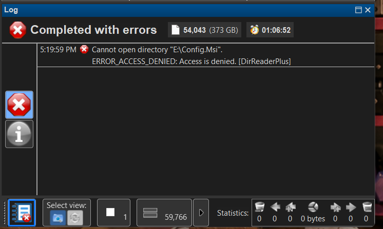
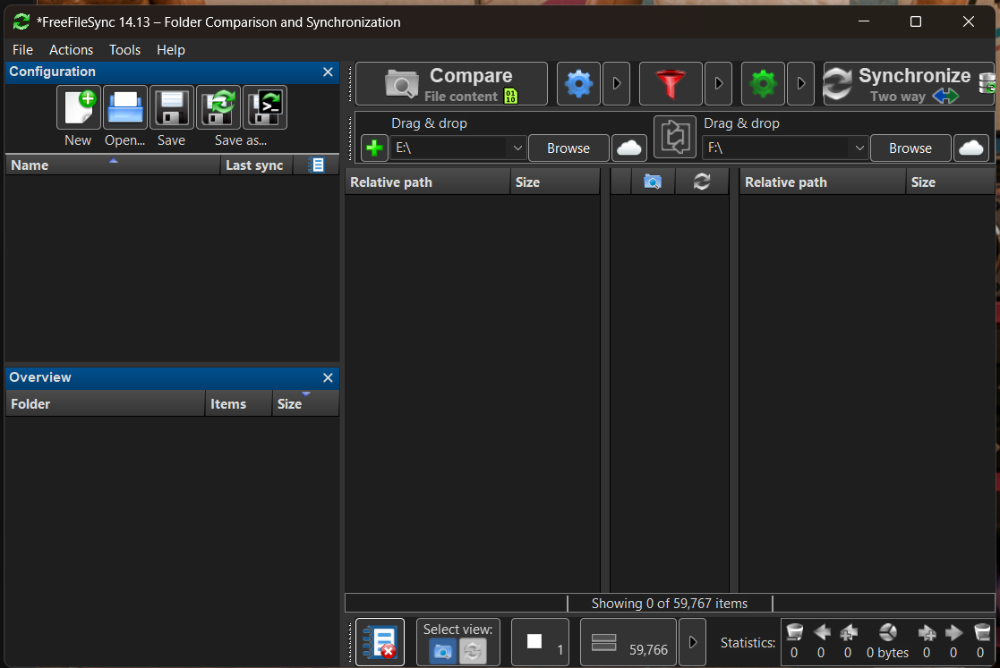

# 03 — Backup and Restoration

## Overview

This activity focused on preserving data from an aging Hitachi internal HDD that exhibited signs of storage degradation.

A previously tested Seagate Portable 2 TB external HDD was prepared as the backup destination. Data was transferred using FreeFileSync, followed by permission troubleshooting, a complete file-content comparison, and independent restoration testing.

The project verified both the completeness of the accessible backup data and the integrity of files restored from the backup.

**Project period:** November 2026

## Objectives

- Preserve accessible data from aging storage hardware.
- Prepare a reliable backup destination.
- Perform a structured file-level backup.
- Investigate and resolve file-access errors.
- Verify backup completeness and file-content integrity.
- Demonstrate successful restoration from the backup.
- Validate restored files using SHA-256 cryptographic hashes.

## Hardware and Environment

| Component | Description |
| :--- | :--- |
| Source drive | Hitachi internal HDD |
| Source drive letter | E: |
| Destination drive | Seagate Portable 2 TB external HDD |
| Destination drive letter | F: |
| Destination filesystem | NTFS |
| Restoration destination | Windows system drive (C:) |
| Operating system | Windows 11 Pro |

> Drive letters reflect the assignments used during this project. Always verify current drive assignments before performing storage operations.

## Tools

| Tool | Purpose |
| :--- | :--- |
| SeaTools | Destination drive diagnostics and preparation |
| FreeFileSync | File backup, directory comparison, and content verification |
| Windows File Explorer | File inspection and restoration |
| Windows Security / NTFS permissions | Access-denied troubleshooting |
| Windows PowerShell | SHA-256 hash generation |
| Get-FileHash | Cryptographic file-integrity verification |

## 1. Source Drive Assessment

The Hitachi HDD was used for long-term storage of documents, photographs, videos, and other personal files.

Diagnostic findings included:

| Indicator | Result |
| :--- | :--- |
| SMART health classification | Caution |
| Reallocated sectors | 1 |
| File accessibility | Accessible |
| Reliability assessment | Potentially degrading |

A reallocated sector does not establish that immediate failure is inevitable. However, it indicates that the drive has encountered a problematic sector and replaced it with a spare.

The existing data was accessible, making a file-level backup the appropriate initial preservation method.

**Decision:** Prioritize backing up the existing data before the drive experiences further degradation.

Additional diagnostic findings are documented in [01 — Storage Device Diagnostics](01-drive-diagnostics.md).

## 2. Backup Destination Preparation

The Seagate Portable 2 TB external HDD was selected as the backup destination after successfully completing extended diagnostic testing.

### Destination preparation

| Activity | Result |
| :--- | :--- |
| SMART assessment | No critical sector-related indicators |
| Long Drive Self Test | PASS |
| Long Generic Test | PASS |
| SeaTools Long Simple Erase | Completed |
| Filesystem preparation | NTFS |
| Drive assignment | F: |

The destination drive was cleared and formatted before the backup operation.

The NTFS filesystem was selected for compatibility with the Windows environment and support for large files, directory structures, and Windows storage-management features.

## 3. FreeFileSync Backup

FreeFileSync was used to compare and transfer data between the Hitachi source drive and Seagate destination drive.

### Backup configuration

| Configuration | Value |
| :--- | :--- |
| Source | Hitachi HDD (E:) |
| Destination | Seagate Portable (F:) |
| Transfer direction | Source to destination |
| Data transferred | Approximately 373 GB |

The backup preserved the source directory structure and copied accessible files to the external destination.

The original Hitachi data was retained during the transfer.

### Transfer verification

Following synchronization, another comparison was performed to identify remaining differences and transfer errors.

The comparison identified an individual file-access problem and an inaccessible Windows Installer system directory.

These exceptions were investigated separately rather than assuming the synchronization had copied every item successfully.

## 4. Permission Troubleshooting and File Recovery

### Initial error

During the backup, FreeFileSync reported an access-denied error involving a JPEG image.

Representative error output:

```text
Cannot copy file.

ERROR_ACCESS_DENIED: Access is denied. [CopyFileEx]
```

The affected image could not be opened normally from the source drive.

Attempts to inspect its security properties also encountered ownership-access limitations.

The file had been transferred between multiple storage devices over time, making inherited or inconsistent NTFS permissions a potential contributing factor.

### Investigation

The troubleshooting process included:

1. Identifying the file reported by FreeFileSync.
2. Attempting to open the original image.
3. Inspecting its Windows security and ownership information.
4. Addressing the file-access problem through Windows permission troubleshooting.
5. Recovering the image to the Seagate destination.
6. Opening the recovered image to verify functionality.
7. Restoring the intended filename.
8. Performing another FreeFileSync comparison.

### Result

| Verification | Result |
| :--- | :--- |
| Original file accessibility | Access denied |
| Recovered destination image | Successfully created |
| Image functionality | Opened successfully |
| Filename restoration | Completed |
| Remaining media access errors | None reported after comparison |

The recovered JPEG was successfully included in the backup.

The exact ownership history and original cause of the permission inconsistency were not established.

### Windows Installer directory exception

FreeFileSync also encountered the following error:

```text
Cannot open directory "E:\Config.Msi".

ERROR_ACCESS_DENIED: Access is denied. [DirReaderPlus]
```

The `Config.Msi` directory is associated with Windows Installer operations.

It was not part of the personal document and media preservation scope.

**Decision:** Record the inaccessible directory as an exception without modifying its permissions or attempting to force its inclusion in the backup.

## 5. Post-Backup Completeness Verification

After resolving the media-access problem, another FreeFileSync comparison was performed.

The comparison confirmed that the accessible source files were present on the destination, with the protected Windows Installer directory remaining an exception.

This verification established backup completeness within the accessible comparison scope.

However, a standard file comparison based on file size and modification time does not independently establish that matching files contain identical bytes.

A separate File Content comparison was therefore performed.

## 6. Full File-Content Integrity Verification

**Verification date:** November 9, 2026

FreeFileSync was configured to compare actual file contents between the Hitachi source and Seagate backup.

### Comparison configuration

| Setting | Value |
| :--- | :--- |
| Source | E: — Hitachi HDD |
| Destination | F: — Seagate Portable |
| Comparison variant | File Content |
| Synchronization | Not performed |
| Operation type | Read-only comparison |

### Procedure

1. Open the existing FreeFileSync backup configuration.
2. Confirm the source and destination paths.
3. Open comparison settings.
4. Select **File Content**.
5. Run the comparison.
6. Record the processing statistics and any errors.
7. Inspect the final comparison results.

The inaccessible `Config.Msi` directory was encountered again and recorded as an exception.

No synchronization or file overwriting was performed during this verification.

### Observed results

| Metric | Result |
| :--- | :--- |
| Comparison duration | 1 hour, 6 minutes, 52 seconds |
| Files processed | 54,043 |
| Data processed | Approximately 373 GB |
| File-content differences | 0 reported |
| Missing or additional accessible files | 0 reported |
| Inaccessible directory | E:\Config.Msi |
| Comparison outcome | PASS within accessible scope |

The final FreeFileSync interface reported 59,767 items in its comparison statistics. This broader item count is retained separately from the 54,043 files reported in the processing log.

#### Supporting Evidence — Comparison Log



*Figure 1. FreeFileSync processed approximately 373 GB across 54,043 files in 1 hour, 6 minutes, and 52 seconds. The protected Config.Msi directory was recorded as an access-denied exception.*

### Assessment

The File Content comparison established that no byte-level differences were detected among the accessible files included in the comparison.

This provided stronger verification than checking file presence, modification time, and file size alone.

The inaccessible Windows Installer directory remained outside the verified scope.

#### Supporting Evidence — Backup Integrity Results



*Figure 2. The final File Content comparison reported no differences among accessible files between the Hitachi source (E:) and Seagate backup (F:).*

## 7. Independent Restoration Testing

A backup should be validated by demonstrating that stored files can be restored and used successfully.

Three representative file types were selected from the Seagate backup:

- JPEG image
- Microsoft Word document
- MKV video

### Restoration environment

A dedicated restoration directory was created on the Windows system drive:

```text
C:\Users\[REDACTED]\OneDrive\Documents\Seagate_Restore_Test
```

The user-specific portion of the path has been redacted for public documentation.

### Procedure

1. Select the three test files from the Seagate backup.
2. Copy the files into the restoration directory on the system drive.
3. Leave the Seagate originals unchanged.
4. Open the restored image.
5. Open the restored Word document.
6. Play the restored video.
7. Record the outcome of each test.

### Results

| File type | Restoration | Functionality |
| :--- | :--- | :--- |
| JPEG image | Successful | Opened successfully |
| DOCX document | Successful | Opened successfully |
| MKV video | Successful | Played successfully |

All three representative files were successfully restored and remained functional.

The restoration test was performed against the backup destination rather than the original Hitachi source.

## 8. SHA-256 Cryptographic Integrity Verification

SHA-256 hashing was used to verify that each restored file was identical to its corresponding Seagate backup file.

### Generate hashes for restored files

The following PowerShell command was used to generate hashes for all files in the restoration directory.

The user-specific portion of the path has been generalized for this documentation.

```powershell
Get-ChildItem "$env:USERPROFILE\OneDrive\Documents\Seagate_Restore_Test" -File |
Get-FileHash -Algorithm SHA256 |
Format-List Path, Hash
```

### Generate hashes for backup originals

The corresponding files were identified on the Seagate drive using their filenames.

The following represents the PowerShell procedure used, with personal filenames replaced by descriptive placeholders.

```powershell
$names = @(
    'sample-image.jpeg'
    'sample-document.docx'
    'sample-video.mkv'
)

Get-ChildItem 'F:\' -Recurse -File -ErrorAction SilentlyContinue |
    Where-Object { $_.Name -in $names } |
    Get-FileHash -Algorithm SHA256 |
    Select-Object Path, Hash |
    Format-List
```

The actual filenames were used during execution.

### Observed SHA-256 results

The following values are the recorded hashes from the actual restoration test.

#### JPEG image

```text
Seagate original:
A30E5836C982B80D081D31C5314B5E89AD43AC6399EBA60DC3B6B727DF16775E

Restored copy:
A30E5836C982B80D081D31C5314B5E89AD43AC6399EBA60DC3B6B727DF16775E

Result: MATCH
```

#### DOCX document

```text
Seagate original:
E836BEDB3A8962815A04443CF9ED0A12FD2999143069290D121CA7B359E34326

Restored copy:
E836BEDB3A8962815A04443CF9ED0A12FD2999143069290D121CA7B359E34326

Result: MATCH
```

#### MKV video

```text
Seagate original:
FDA273C9D277D4BA6018EC808F49CA952B84F2506A997A419709A87952D64141

Restored copy:
FDA273C9D277D4BA6018EC808F49CA952B84F2506A997A419709A87952D64141

Result: MATCH
```

### Integrity verification summary

| File type | Hash algorithm | Hash comparison | Result |
| :--- | :--- | :--- | :--- |
| JPEG | SHA-256 | Identical | PASS |
| DOCX | SHA-256 | Identical | PASS |
| MKV | SHA-256 | Identical | PASS |

**Overall result: 3 of 3 hash pairs matched.**

The matching SHA-256 hashes establish that the restored test files contained the same bytes as their corresponding backup originals.

## 9. Final Backup Assessment

| Verification | Result |
| :--- | :--- |
| Destination drive diagnostics | PASS |
| File backup operation | Completed |
| Media permission troubleshooting | Resolved |
| Post-backup file comparison | PASS within accessible scope |
| Full File Content comparison | No differences reported |
| Independent restoration | 3 of 3 files restored |
| Functional restoration tests | 3 of 3 files opened |
| SHA-256 verification | 3 of 3 hash pairs matched |
| Documented exception | Protected Config.Msi directory |

The accessible backup data was successfully transferred and independently verified.

The Seagate drive subsequently became an encrypted backup device using BitLocker To Go.

The encryption procedure and security verification are documented in [04 — Encryption and Security](04-encryption-and-security.md).

## Lessons Learned

- Data preservation should take priority when storage hardware begins showing signs of degradation.
- Backup destinations should be assessed for reliability before use.
- Successful synchronization does not eliminate the need to review transfer errors.
- NTFS permissions can prevent otherwise intact files from being copied or accessed.
- Protected operating system directories should be evaluated against the actual backup scope before changing their permissions.
- File presence, file size, and modification time are not equivalent to byte-for-byte content verification.
- Backup validation should include an actual restoration test.
- SHA-256 hashes provide a reliable method of comparing original and restored file contents.
- Backup exceptions and verification limitations should be documented rather than ignored.

## Limitations

- The protected Windows Installer directory `E:\Config.Msi` could not be inspected or included in the verified backup scope.
- Restoration testing used three representative files rather than restoring the entire backup.
- SHA-256 verification was performed on the three restored test files, not individually on every file in the backup.
- The full File Content comparison applied to the accessible files at the time of verification. Subsequent file changes are outside that verification event.
- The project demonstrated file-level backup and restoration, not a complete operating system or bare-metal recovery.
- A single external backup does not independently satisfy a comprehensive 3-2-1 backup strategy.
- The precise cause of the recovered JPEG's historical permission issue was not established.

## Conclusion

This activity demonstrated a complete file-level backup workflow, from identifying storage degradation and preparing backup hardware through data transfer, permission troubleshooting, integrity comparison, and successful restoration.

Approximately 373 GB of accessible data was backed up and verified through a complete file-content comparison. Three representative files were restored successfully, opened without errors, and independently verified using SHA-256 hashes.

The results demonstrate practical experience with data preservation, Windows storage troubleshooting, backup validation, cryptographic integrity verification, and evidence-based technical documentation.

## Navigation

- [Return to Storage Lifecycle Management](README.md)
- [Previous: Forensic Imaging and Recovery](02-forensic-imaging-and-recovery.md)
- [Next: Encryption and Security](04-encryption-and-security.md)
