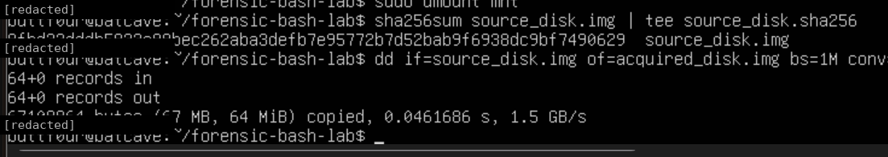
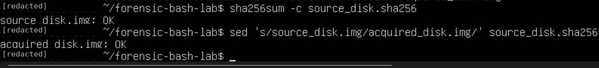
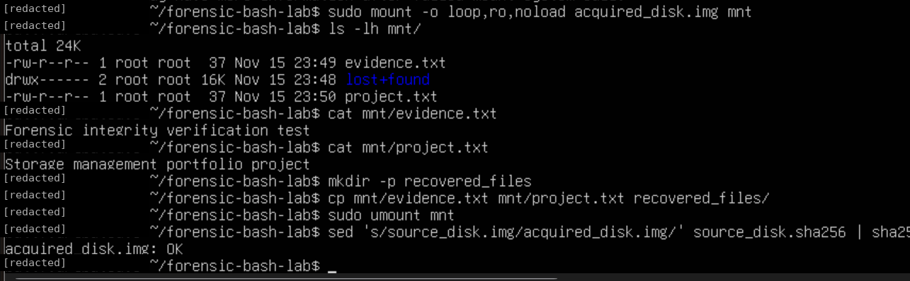

# 06 — Forensic Image Verification

## Overview

This activity demonstrated cryptographic integrity verification of a sector-level disk image using a controlled Linux virtual lab.

The original Western Digital recovery investigation successfully demonstrated acquisition and recovery analysis of a failing physical HDD. However, a SHA-256 checksum was not retained for that original disk image.

A separate controlled experiment was therefore conducted using a 64 MiB raw virtual disk containing known test files.

The experiment demonstrated source hashing, sector-level acquisition, cryptographic verification, read-only filesystem inspection, file extraction, and post-recovery integrity verification.

**Project date:** November 15, 2026

## Objectives

- Create a controlled virtual storage device.
- Establish a known filesystem and test data.
- Generate a cryptographic hash of the source before acquisition.
- Create a complete sector-level disk image.
- Verify that the acquired image matches the original source.
- Inspect the acquired image without modifying its contents.
- Extract files from the acquired image.
- Verify that the image remains unchanged following recovery operations.

## Hardware and Lab Environment

| Component | Description |
| :--- | :--- |
| Host workstation | Razer Blade 15 Advanced |
| Virtualization platform | Oracle VirtualBox |
| Guest operating system | Ubuntu Server |
| Source storage | 64 MiB raw virtual disk file |
| Filesystem | ext4 |
| Acquisition destination | Separate raw disk image |
| Integrity algorithm | SHA-256 |

This activity used regular disk-image files inside the virtual machine rather than a physical storage device.

No existing physical drives, operating system partitions, or backup data were modified.

## Tools

| Tool | Purpose |
| :--- | :--- |
| dd | Create and acquire raw disk images |
| mkfs.ext4 | Create an ext4 filesystem |
| mount | Attach a disk image through a loop device |
| umount | Safely detach the mounted filesystem |
| sha256sum | Generate and verify SHA-256 checksums |
| tee | Save checksum output to a file |
| sed | Adjust the checksum filename for verification |
| ls | Inspect files and directories |
| cat | Display recovered file contents |
| cp | Extract files from the acquired image |
| mkdir | Create working and recovery directories |

## 1. Create the Controlled Source Disk

A dedicated working directory was created inside the Ubuntu Server virtual machine.

```bash
mkdir -p ~/forensic-bash-lab
cd ~/forensic-bash-lab
```

A 64 MiB raw disk file was created using zero-filled data:

```bash
dd if=/dev/zero of=source_disk.img bs=1M count=64 conv=excl status=progress
```

### Command explanation

| Parameter | Purpose |
| :--- | :--- |
| if=/dev/zero | Supply zero-valued bytes |
| of=source_disk.img | Define the output disk-image file |
| bs=1M | Use 1 MiB blocks |
| count=64 | Write 64 blocks |
| conv=excl | Prevent overwriting an existing output file |
| status=progress | Display acquisition progress |

### Recorded output

```text
64+0 records in
64+0 records out
67108864 bytes (67 MB, 64 MiB) copied, 0.0341939 s, 2.0 GB/s
```

### Result

| Property | Result |
| :--- | :--- |
| Source image | source_disk.img |
| Logical size | 67,108,864 bytes |
| Capacity | 64 MiB |
| Records written | 64 of 64 |
| Reported errors | None after command correction |

The controlled source disk was successfully created.

## 2. Filesystem Creation and Test Data Preparation

An ext4 filesystem was created inside the source image:

```bash
mkfs.ext4 -F source_disk.img
```

### Recorded filesystem information

```text
mke2fs 1.47.0 (5-Feb-2023)

Creating filesystem with 16384 4k blocks and 16384 inodes

Allocating group tables: done
Writing inode tables: done
Creating journal (1024 blocks): done
Writing superblocks and filesystem accounting information: done
```

The filesystem was then mounted through a loop device:

```bash
mkdir -p mnt
sudo mount -o loop source_disk.img mnt
```

Two known test files were created:

```bash
echo "Forensic integrity verification test" |
sudo tee mnt/evidence.txt
```

```bash
echo "Storage management portfolio project" |
sudo tee mnt/project.txt
```

The files were inspected:

```bash
ls -lh mnt/
```

### Recorded test data

| File | Size | Contents |
| :--- | ---: | :--- |
| evidence.txt | 37 bytes | Forensic integrity verification test |
| project.txt | 37 bytes | Storage management portfolio project |
| lost+found | 16 KiB | Standard ext4 recovery directory |

The source filesystem was unmounted:

```bash
sudo umount mnt
```

Unmounting ensured that pending filesystem changes were written before the source image was hashed and acquired.

The source image was not mounted for writing again during the remaining investigation.

## 3. Establish the Original SHA-256 Baseline

Before acquiring the forensic image, a SHA-256 checksum was generated for the original source.

```bash
sha256sum source_disk.img | tee source_disk.sha256
```

### Recorded SHA-256 hash

```text
8fbd32dddb5833e99bec262aba3defb7e95772b7d52bab9f6938dc9bf7490629
```

The checksum was saved in:

```text
source_disk.sha256
```

### Purpose

SHA-256 produces a 256-bit cryptographic digest represented by 64 hexadecimal characters.

The original checksum established a baseline against which the acquired image could be compared.

Any subsequent modification to the source or acquired image would be expected to produce a different SHA-256 value.

The checksum was generated before acquisition to establish the source's recorded state.

## 4. Sector-Level Image Acquisition

The source disk image was copied using `dd`:

```bash
dd if=source_disk.img of=acquired_disk.img bs=1M conv=excl status=progress
```

Unlike an ordinary file-level backup, this operation copied the entire raw source image, including:

- Filesystem metadata.
- File contents.
- Filesystem journal.
- Allocated storage regions.
- Unallocated space within the image.

### Recorded acquisition output

```text
64+0 records in
64+0 records out
67108864 bytes (67 MB, 64 MiB) copied, 0.0461686 s, 1.5 GB/s
```

### Acquisition results

| Metric | Result |
| :--- | :--- |
| Source | source_disk.img |
| Destination | acquired_disk.img |
| Bytes acquired | 67,108,864 |
| Records copied | 64 of 64 |
| Acquisition duration | 0.0461686 seconds |
| Reported throughput | 1.5 GB/s |
| Reported errors | None |

The source and acquired images had identical logical sizes.

#### Supporting Evidence — Forensic Image Acquisition



*Figure 1. SHA-256 baseline generation followed by successful sector-level acquisition of the 64 MiB virtual disk using dd.*

The reported acquisition throughput reflects a small file-based operation inside a virtual environment and should not be interpreted as a physical HDD performance benchmark.

### Acquisition method comparison

The original failing Western Digital HDD was acquired using GNU ddrescue because the physical device contained unreadable sectors.

This controlled virtual disk was acquired using `dd` because the source was small, stable, and readable.

| Tool | Application |
| :--- | :--- |
| GNU ddrescue | Fault-tolerant acquisition from a failing physical disk |
| dd | Complete acquisition from a controlled, readable source |

The original physical drive acquisition is documented in [02 — Forensic Imaging and Recovery](02-forensic-imaging-and-recovery.md).

## 5. Cryptographic Image Integrity Verification

A SHA-256 checksum was generated for the acquired image:

```bash
sha256sum acquired_disk.img | tee acquired_disk.sha256
```

The original source was independently checked against its saved baseline:

```bash
sha256sum -c source_disk.sha256
```

### Recorded result

```text
source_disk.img: OK
```

This confirmed that the original source image remained unchanged since its initial checksum was generated.

### Verify the acquired image against the original baseline

The original checksum was reused with the acquired image's filename:

```bash
sed 's/source_disk.img/acquired_disk.img/' source_disk.sha256 |
sha256sum -c -
```

The `sed` command changed the filename in the checksum record without changing the expected SHA-256 value.

The resulting checksum record was passed to `sha256sum` for verification.

### Recorded result

```text
acquired_disk.img: OK
```

### Integrity comparison

| Image | SHA-256 result |
| :--- | :--- |
| Original source | 8fbd32dddb5833e99bec262aba3defb7e95772b7d52bab9f6938dc9bf7490629 |
| Acquired image | Matches original baseline |
| Original source verification | PASS |
| Acquired image verification | PASS |

The acquired image matched the SHA-256 checksum established before acquisition.

This provided cryptographic evidence that the acquired disk image contained the same bytes as the original source.

#### Supporting Evidence — Cryptographic Integrity Verification



*Figure 2. SHA-256 verification confirmed that the original source remained unchanged and that the acquired image matched the original cryptographic baseline.*

## 6. Read-Only Forensic Image Inspection

The acquired image was mounted for inspection without modifying the original source.

```bash
sudo mount -o loop,ro,noload acquired_disk.img mnt
```

### Mount options

| Option | Purpose |
| :--- | :--- |
| loop | Expose the image file through a loop device |
| ro | Mount the filesystem read-only |
| noload | Prevent ext4 journal replay during mounting |

The `noload` option was included because ext4 journal replay can otherwise introduce filesystem changes under certain mounting conditions.

The source image remained unmounted.

### Inspect the acquired filesystem

```bash
ls -lh mnt/
```

### Recorded directory contents

```text
-rw-r--r-- 1 root root 37 evidence.txt
drwx------ 2 root root 16K lost+found
-rw-r--r-- 1 root root 37 project.txt
```

Both test files and the standard ext4 recovery directory were present.

### Inspect file contents

```bash
cat mnt/evidence.txt
cat mnt/project.txt
```

### Recorded output

```text
Forensic integrity verification test
Storage management portfolio project
```

The contents matched the known data originally written to the source filesystem.

## 7. File Extraction from the Acquired Image

A separate recovery directory was created:

```bash
mkdir -p recovered_files
```

Both test files were extracted from the mounted forensic image:

```bash
cp mnt/evidence.txt mnt/project.txt recovered_files/
```

The acquired filesystem was then unmounted:

```bash
sudo umount mnt
```

### Recovery results

| File | Original size | Result |
| :--- | ---: | :--- |
| evidence.txt | 37 bytes | Successfully extracted |
| project.txt | 37 bytes | Successfully extracted |

The extraction operation copied existing files from the acquired image to a separate directory.

Neither the original source image nor the acquired image was intentionally modified.

This demonstrated successful recovery of accessible files from a forensic image, rather than recovery of deleted or damaged files.

## 8. Post-Recovery Integrity Verification

After filesystem inspection and file extraction, the acquired image was checked again against the original SHA-256 baseline.

```bash
sed 's/source_disk.img/acquired_disk.img/' source_disk.sha256 |
sha256sum -c -
```

### Recorded result

```text
acquired_disk.img: OK
```

The acquired image's SHA-256 checksum remained consistent with the original source baseline after the inspection and extraction operations.

### Verification sequence

| Stage | Verification | Result |
| :--- | :--- | :--- |
| Before acquisition | Record source SHA-256 checksum | PASS |
| After acquisition | Verify original source against baseline | PASS |
| After acquisition | Verify acquired image against baseline | PASS |
| During inspection | Mount acquired image read-only | PASS |
| During extraction | Access and extract both test files | PASS |
| After recovery | Reverify acquired image against baseline | PASS |

**Overall result:** The acquired forensic image retained its original cryptographic integrity throughout the completed investigation.

#### Supporting Evidence — Read-Only Extraction and Final Verification



*Figure 3. Successful read-only filesystem inspection, extraction of both test files, and final SHA-256 verification confirming that the acquired image remained unchanged.*

## 9. Troubleshooting During Implementation

Several minor command-entry issues occurred during the lab and were corrected before proceeding.

### Invalid dd conversion option

An initial command used an incorrect conversion option:

```text
dd: invalid conversion: 'excel'
```

The correct option was:

```bash
conv=excl
```

The corrected command successfully created the source image.

### Incorrect unmount command

An initial unmount attempt returned:

```text
sudo: unmount: command not found
```

The correct Linux command was:

```bash
sudo umount mnt
```

The filesystem was subsequently unmounted successfully.

### Incorrect read-only mount option

An initial mount attempt used `no` instead of `ro`.

The recorded error included:

```text
ext4: Unknown parameter 'no'
```

The corrected command was:

```bash
sudo mount -o loop,ro,noload acquired_disk.img mnt
```

The acquired image subsequently mounted successfully.

The final SHA-256 verification confirmed that the acquired image remained consistent with the original baseline.

### Troubleshooting assessment

These issues were command-entry errors rather than evidence of filesystem corruption or failed acquisition.

Each error was identified through terminal output and corrected before continuing.

## 10. Preserved Lab Artifacts

The completed virtual lab was retained inside the Ubuntu Server virtual machine.

The working directory was inspected using:

```bash
ls -lh ~/forensic-bash-lab
```

### Final artifact inventory

| Artifact | Purpose |
| :--- | :--- |
| source_disk.img | Original 64 MiB raw source disk |
| acquired_disk.img | Cryptographically verified forensic image |
| source_disk.sha256 | Original source checksum |
| acquired_disk.sha256 | Acquired image checksum |
| recovered_files/ | Extracted test files |
| mnt/ | Filesystem mount directory |

Both disk images and their corresponding checksum files were retained.

The image was unmounted before the virtual machine was shut down.

The artifacts remain available for subsequent inspection or verification.

> The raw 64 MiB disk images are retained locally in the virtual environment rather than uploaded to this documentation repository.

## Final Verification Results

| Activity | Result |
| :--- | :--- |
| Controlled virtual disk creation | PASS |
| ext4 filesystem creation | PASS |
| Known test data creation | PASS |
| Original source SHA-256 baseline | PASS |
| Complete sector-level acquisition | PASS |
| Original source integrity verification | PASS |
| Acquired image integrity verification | PASS |
| Read-only filesystem inspection | PASS |
| Test file extraction | PASS |
| Post-recovery image integrity verification | PASS |
| Preservation of lab artifacts | PASS |

## Lessons Learned

- Cryptographic checksums should be generated before acquisition whenever practical.
- Acquisition success and cryptographic integrity verification are distinct requirements.
- Identical file sizes do not independently establish identical content.
- A raw disk image preserves filesystem structures and storage regions beyond individual files.
- SHA-256 verification can establish whether an acquired image matches a recorded source baseline.
- Read-only mounting reduces the risk of modifying acquired data.
- Filesystem-specific options should be considered when preserving image integrity.
- Recovery operations should be performed against the acquired image rather than the original source.
- Post-investigation hashing provides evidence that an image remained unchanged throughout the completed workflow.
- Small controlled virtual disks provide an efficient environment for demonstrating forensic acquisition procedures.
- Technical documentation should distinguish between physical-drive recovery investigations and controlled verification experiments.

## Limitations

- This activity used a 64 MiB file-based virtual disk rather than a physical HDD.
- The controlled source did not contain bad sectors or physical hardware failures.
- The experiment demonstrated extraction of existing files, not recovery of deleted files.
- Individual extracted files were not independently hashed during this activity.
- The acquired image's integrity was verified against the original virtual disk baseline, not the original Western Digital physical disk.
- The original physical WD image had already been removed before this verification experiment.
- The activity did not implement a formal legal chain-of-custody process or hardware write-blocking device.
- Acquisition throughput reflects the virtual lab environment rather than physical storage performance.

## Conclusion

This activity successfully demonstrated a complete cryptographic disk-image verification workflow using a controlled Linux virtual environment.

A known source filesystem was created, hashed, and acquired as a separate raw disk image. SHA-256 verification established that the acquired image matched the original source.

The acquired image was then mounted read-only, inspected, and used to extract two test files. A final checksum comparison confirmed that the acquired image retained its original integrity following the recovery operation.

Combined with the original Western Digital forensic recovery investigation, this activity demonstrates practical experience with sector-level acquisition, cryptographic integrity verification, read-only filesystem inspection, and evidence-preserving recovery procedures.

## Navigation

- [Return to Storage Lifecycle Management](README.md)
- [Previous: Sanitization and Retirement](05-sanitization-and-retirement.md)
- [Return to IT Infrastructure Labs](../README.md)
