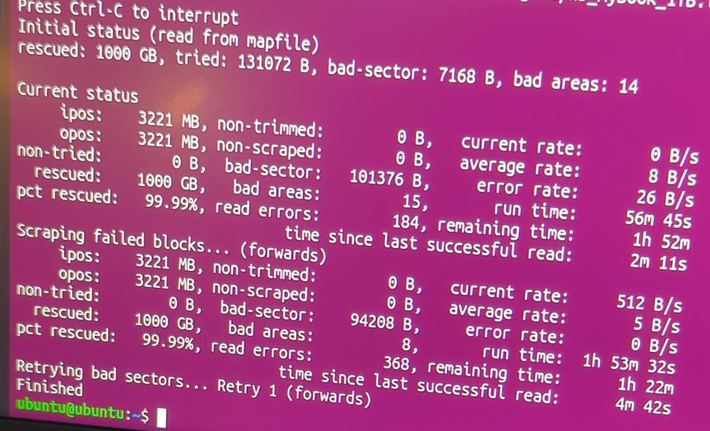
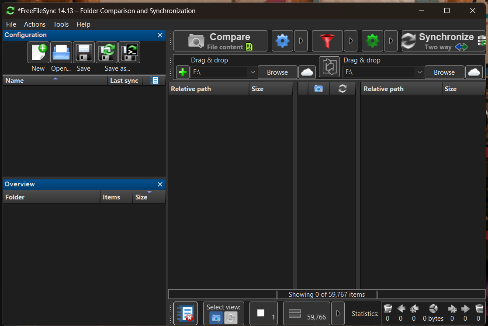
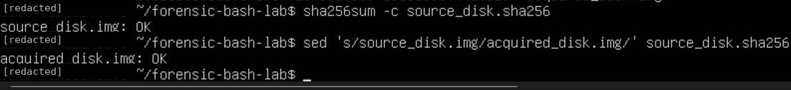

# Storage Lifecycle Management

## Project Overview

An end-to-end, hands-on storage management project covering drive diagnostics, forensic imaging, data recovery, backup and restoration, encryption, secure sanitization, and hardware retirement.

This project was conducted using physical storage devices and a controlled Linux virtual lab. All technical results are based on actual implementation and testing.

## Objectives

- Assess storage device health and identify failing hardware.
- Preserve data through sector-level forensic imaging.
- Investigate previously deleted data and evaluate recovery potential.
- Back up data from aging storage hardware.
- Verify backup integrity and demonstrate successful restoration.
- Protect stored data using encryption and recovery-key management.
- Securely sanitize and retire obsolete storage devices.
- Verify forensic image integrity using SHA-256 hashing.

## Hardware and Lab Environment

| Component | Description |
| :--- | :--- |
| Western Digital My Book 1 TB | Failing external HDD used for forensic imaging and recovery investigation |
| Western Digital 10EAVS 1 TB | External HDD used for secure sanitization and retirement |
| Hitachi HDD | Aging internal HDD used as the backup source |
| Seagate Portable 2 TB | Backup destination and encrypted external storage |
| Windows 11 Pro Desktop | Diagnostics, backup, encryption, and sanitization |
| Razer Blade 15 | Windows 11 Home workstation used for encryption and compatibility testing |
| Razer Thunderbolt 4 Dock | External storage connectivity and troubleshooting |
| Ubuntu Linux | Physical drive imaging and recovery investigation |
| Ubuntu Server / VirtualBox | Controlled forensic image integrity verification lab |

## Project Activities

| Activity | Tools | Outcome |
| :--- | :--- | :--- |
| [01 — Drive Diagnostics](01-drive-diagnostics.md) | SeaTools, SMART, Windows storage utilities | Identified healthy backup hardware and drives requiring retirement |
| [02 — Forensic Imaging and Recovery](02-forensic-imaging-and-recovery.md) | GNU ddrescue, TestDisk, PhotoRec, Linux | Acquired and investigated a failing 1 TB HDD; no recoverable media found |
| [03 — Backup and Restoration](03-backup-and-restoration.md) | FreeFileSync, PowerShell, SHA-256 | Backed up approximately 373 GB and verified data integrity |
| [04 — Encryption and Security](04-encryption-and-security.md) | BitLocker, BitLocker To Go, TPM 2.0, manage-bde | Implemented and verified storage encryption and cross-device access |
| [05 — Sanitization and Retirement](05-sanitization-and-retirement.md) | DiskPart, PowerShell, C# | Completed full-drive overwrite and sampled read-back verification |
| [06 — Forensic Image Verification](06-forensic-image-verification.md) | Ubuntu Server, dd, sha256sum, ext4 | Verified a sector-level image using SHA-256 and read-only file extraction |

## Key Results

| Verification | Result |
| :--- | :--- |
| Physical drive forensic acquisition | 99.99% recovered; unreadable areas documented |
| Deleted media recovery investigation | No recoverable media identified |
| Data backup | Approximately 373 GB transferred |
| Full backup content comparison | No differences among accessible files |
| Restoration testing | Three different file types successfully restored and opened |
| Restored file SHA-256 verification | 3 of 3 hash pairs matched |
| Seagate BitLocker encryption | 100% encrypted; AES-128; protection enabled |
| Laptop device encryption | TPM-backed protection verified |
| Cross-device compatibility | Encrypted backup successfully accessed on Windows 11 Pro and Home |
| Secure HDD overwrite | Completed successfully using DiskPart clean all |
| Independent sanitization verification | 5 of 5 sampled regions contained only zeros |
| Hardware retirement | Both Western Digital HDDs recycled |
| Controlled forensic image verification | Source and acquired image SHA-256 hashes matched |
| Read-only image extraction | Successful; image integrity preserved |

## Project Evidence Highlights

Selected evidence from the completed storage lifecycle activities. Expand each section to view the corresponding technical results.

<strong>Forensic Acquisition — Failing Physical HDD</strong>

 

GNU ddrescue acquisition of a failing Western Digital 1 TB HDD, with approximately 99.99% of the disk recovered and unreadable regions documented.

[View the complete forensic imaging and recovery investigation](02-forensic-imaging-and-recovery.md)

<strong>Backup Integrity — 373 GB Verified</strong>

 

Full file-content comparison between the Hitachi source and Seagate backup, with no differences reported among accessible files.

[View the complete backup and restoration procedure](03-backup-and-restoration.md)

<strong>Cryptographic Integrity — SHA-256 Verification</strong>

 

Successful SHA-256 verification of a sector-level disk image acquired in a controlled Ubuntu Server virtual lab.

[View the complete forensic image verification procedure](06-forensic-image-verification.md)

[View all supporting evidence](evidence/README.md)

## Technical Skills Demonstrated

- Storage hardware diagnostics and failure assessment
- Linux-based sector-level disk acquisition
- Filesystem inspection and data recovery investigation
- Data migration and backup management
- NTFS permission troubleshooting
- Byte-for-byte content comparison
- Cryptographic integrity verification
- Windows storage encryption and recovery-key management
- USB and Thunderbolt connectivity troubleshooting
- Secure data sanitization and hardware retirement
- Technical documentation and evidence-based decision-making

## Limitations and Scope

- The original Western Digital recovery investigation did not identify recoverable media. This outcome does not establish that recovery would be impossible using specialized professional equipment.
- Cryptographic verification of a complete disk image was demonstrated separately in a controlled 64 MiB virtual disk lab.
- The backup comparison excluded an inaccessible Windows Installer system directory.
- Sanitization verification consisted of sampled read-back checks. Inaccessible or remapped sectors could not be independently verified.

## Conclusion

This project demonstrates the complete operational lifecycle of storage devices, from initial health assessment and data preservation through backup validation, encryption, sanitization, and retirement.

The work emphasizes protecting data before destructive operations, selecting appropriate troubleshooting and recovery methods, independently verifying results, and documenting technical limitations.

## Navigation

[Return to IT Infrastructure Labs](../README.md)
